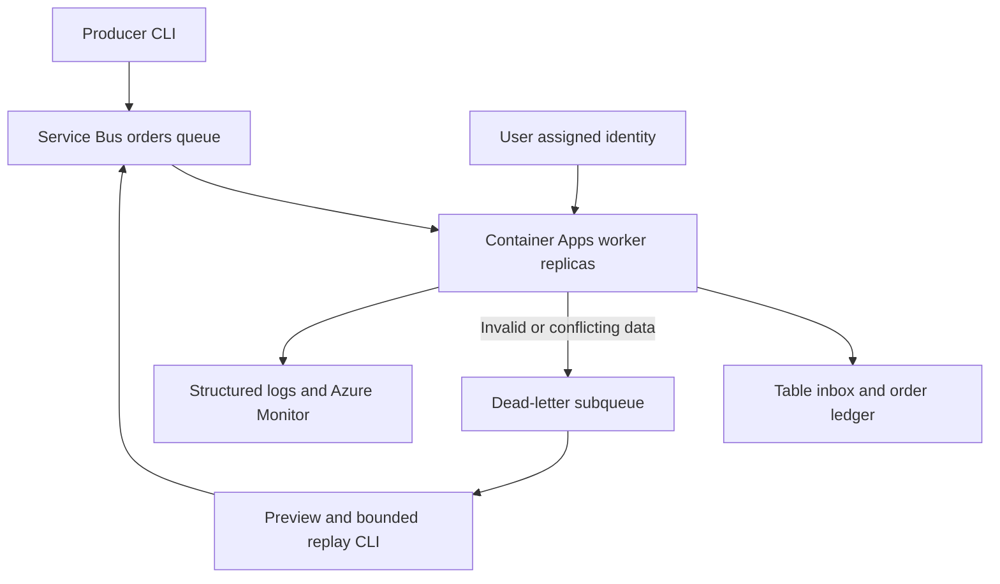

# Azure Service Bus Order Processing

An event-driven order ledger on Azure Container Apps, Service Bus Standard and Azure Table
Storage. The implementation handles concurrent duplicate messages, conflicting idempotency
keys, crashes between persistence and acknowledgement, poison messages and bounded dead-letter
replay. It includes working Python source, Bicep, a non-root Docker image, dependency hashes,
CI, manual OIDC deployment, a dead-letter metric alert and operational runbooks.

The business effect is recording an immutable order. This is intentionally not a payment,
inventory or shipping system. Recording an order and its inbox entry is one Table transaction;
acknowledging its Service Bus delivery happens afterward. That ordering is the core reliability
contract. Local tests exercise it independently from the Azure adapters.

## Architecture



The worker has no HTTP ingress. KEDA checks the orders queue with managed identity, starts at
zero replicas, targets five queued messages per replica, and is capped at three replicas by
default (the template permits at most five). Each replica receives one message at a time with
prefetch disabled, so it does not collect a backlog of locks that expire while waiting.

A SHA-256 hash of tenant_id is the Table PartitionKey. Hashed event and order IDs are distinct
RowKeys within that partition. Two conditional creates place the inbox record and order record
in the same atomic batch. If a replica races another, the losing batch rolls back and the
adapter reconciles the winner's records. Reusing the same identifier with different order
content is a conflict and is dead-lettered; it is never silently treated as a valid duplicate.

A new event ID referencing an already recorded identical order binds that event ID separately,
without creating a second order. This also prevents that event ID being reused later for some
other order. Event IDs are tenant-scoped, not globally unique across tenants. The producer hashes tenant_id
and event_id together for the queue-wide broker MessageId, preventing cross-tenant suppression. Currency and
integer cents are part of the business fingerprint; event_id is not. All original ledger and
inbox records are retained until an operator explicitly manages retention.

## Prerequisites

For local validation: Python 3.12, Git, Bash, Azure CLI with Bicep, and internet access to fetch
pinned Python dependencies/compiler types. Azure authentication is unnecessary for unit tests
and Bicep compilation. On Windows use VS Code with Git Bash for the commands below.

For optional deployment: a commercial Azure subscription, a dedicated sandbox resource group,
Container Apps availability and quota in the region, an Entra deployment principal, GitHub
Actions enabled for this repository, and permissions to create workload resources and role
assignments in that resource group. Azure deployment and service operation incur charges.
Source publication and offline tests do not require OpenAI APIs or AI automation credentials.

## Local setup and validation

```bash
git clone https://github.com/dotman01k/azure-servicebus-order-processing.git
cd azure-servicebus-order-processing
python -m venv .venv
# Git Bash on Windows:
source .venv/Scripts/activate
# Linux/macOS instead: source .venv/bin/activate
python -m pip install --require-hashes -r requirements.lock
az bicep install
bash scripts/validate.sh
```

The script runs behavior tests, Bash syntax checks, compiles both Bicep templates and inspects
the resulting ARM JSON for deployment/security invariants. Azure CLI Bicep installation may
use a different compiler version later; the development evidence records the version actually
tested. To use a separately installed compiler, set BICEP_BIN to its absolute path.

The lock file includes all resolved transitive packages and accepted artifact hashes for
Python 3.12. To update dependencies deliberately, install pip-tools in a separate development
environment and run `pip-compile --generate-hashes --output-file requirements.lock requirements.in`,
then retest. The Docker base is a maintained Python 3.12 Debian tag rather than an immutable
base digest; deployment uses the resulting application image's immutable registry digest.

## Exact Azure setup and deployment

The normal deployment path is the manual **Preview or deploy sandbox** GitHub workflow.
Nothing deploys on push. Its default operation is preview; apply is an explicit operator
choice in the azure-dev environment. Configure required reviewers and restrict deployment
branches to main in GitHub environment settings. Merely naming an environment does not create
an approval gate. Prerequisites and complete OIDC bootstrap are in [identity setup](docs/identity.md).

The resource group is deliberately supplied by the operator. Create a dedicated one only when
you are ready for Azure charges:

```bash
az login
export AZURE_SUBSCRIPTION_ID='<your-sandbox-subscription-id>'
export RESOURCE_GROUP='rg-orders-dev'
export PREFIX='orderlab'
az account set --subscription "$AZURE_SUBSCRIPTION_ID"
az group create --name "$RESOURCE_GROUP" --location eastus \
  --tags project=servicebus-order-processing environment=dev
```

Resource providers Microsoft.App, Microsoft.ServiceBus, Microsoft.Storage,
Microsoft.ContainerRegistry, Microsoft.OperationalInsights, Microsoft.ManagedIdentity and
Microsoft.Insights must be registered in the subscription. Have a subscription operator
register any missing providers; the RG-scoped deployment identity is not granted that authority.

In GitHub's azure-dev environment, set AZURE_CLIENT_ID, AZURE_TENANT_ID,
AZURE_SUBSCRIPTION_ID, RESOURCE_GROUP, PREFIX, and optionally OPERATOR_OBJECT_ID plus
OPERATOR_PRINCIPAL_TYPE (User, Group or ServicePrincipal). The optional operator receives
queue sender/receiver and table reader access, not ledger write access. Set OPERATOR_OBJECT_ID
to your signed-in Entra object ID for the demo and recovery commands; leaving it blank grants
no operator data-plane roles. IDs are configuration variables, not client secrets.

Run the workflow with preview. Review the foundation changes. Then request apply, approve the
environment if reviewers are configured, and inspect its outcome. Apply deploys the foundation,
builds the checked-out commit with ACR Tasks, obtains its SHA-256 image digest, previews the
worker and deploys the worker using that digest. It does not use registry admin credentials or
a public image. The ACR build requires a clean checkout and access to the upstream Python image
and package registry. If registry task capability is unavailable for your subscription, build
and push with Docker using an appropriately scoped ACR build identity before the worker stage.

The equivalent local operational commands are supplied for debugging and controlled development:

```bash
export OPERATOR_OBJECT_ID="$(az ad signed-in-user show --query id -o tsv)"
export OPERATOR_PRINCIPAL_TYPE='User'
bash scripts/deploy.sh preview
# Only after review:
export CONFIRM_DEPLOY="$RESOURCE_GROUP"
bash scripts/deploy.sh apply
```

Foundation includes the namespace/queue, Table ledger, Basic ACR, user-assigned identity,
Log Analytics workspace, Consumption Container Apps environment, scoped role grants and a
queue dead-letter alert. Worker deployment is separate to avoid the initial image bootstrap
cycle. A foundation preview does not prove that image pull, RBAC propagation or application
startup will succeed. Re-run the same committed deployment after resolving temporary RBAC
propagation failures; do not replace managed identity with shared keys.

## Send and verify an order

For local operator commands, use your Entra CLI login. Set connection metadata from the
foundation deployment, without retrieving any access keys:

```bash
export SERVICEBUS_NAMESPACE="$(az deployment group show -g "$RESOURCE_GROUP" \
  -n orders-foundation --query properties.outputs.namespace.value -o tsv)"
export TABLE_ENDPOINT="$(az deployment group show -g "$RESOURCE_GROUP" \
  -n orders-foundation --query properties.outputs.tableEndpoint.value -o tsv)"
export QUEUE_NAME='orders'
export TABLE_NAME='OrderLedger'
unset AZURE_CLIENT_ID
python -m orders send examples/order.json
python -m orders list-orders
```

The client explicitly uses AzureCliCredential locally and ManagedIdentityCredential when
AZURE_CLIENT_ID is set in the worker. It never falls back to a client-secret environment
credential. `send` confirms broker acceptance, not business completion. Allow the scaler's
30-second polling and cold start time; inspect the ledger and logs to verify processing.
`list-orders` prints at most the first 100 results and is a demo inspection tool, not a full
export API. Repeating the sample event immediately may be suppressed by broker duplicate
detection before the application sees it. Application inbox protection still applies after
the broker's ten-minute duplicate window.

## Identity and RBAC

| Identity | Scope | Permission |
| --- | --- | --- |
| Worker user-assigned identity | orders queue | Azure Service Bus Data Receiver; also used by the KEDA scaler |
| Worker user-assigned identity | OrderLedger table | Storage Table Data Contributor |
| Worker user-assigned identity | project ACR | AcrPull |
| Optional operator | orders queue | Azure Service Bus Data Sender and Data Receiver for producer/DLQ replay |
| Optional operator | OrderLedger table | Storage Table Data Reader |
| Deployment principal | dedicated project resource group | Contributor plus Role Based Access Control Administrator for the declared role assignments |

The built-in Table contributor role permits entity deletion, even though this application's
adapter only creates and reads. A custom role can narrow data actions in a production extension.
The deployment principal can grant roles in its dedicated RG; that is a privileged capability,
so keep it isolated, use an environment approval gate and consider RBAC assignment conditions.
No subscription Owner grant, Service Bus SAS key, storage account key or ACR admin password is
required by this application. Container Apps passes the platform's Log Analytics workspace key
internally when configuring log delivery; it is not output or committed.

## Operations and troubleshooting

See [the runbook](docs/operations.md) for DLQ preview/replay, invalid payload repair, crash
recovery, rollback and KQL. The worker logs JSON outcome counts and error class names instead
of complete order bodies, credentials or customer data. The deployed metric alert fires when
DeadletteredMessages exceeds zero over five minutes for the orders queue. It has no action
group: attach your organization's notification action group to receive email or incident alerts.
KQL queries are in docs/queries.kql. Log ingestion may lag and the one-GB daily workspace cap
is a cost-control aid, not a guarantee against every ingestion charge.

| Symptom | Investigation |
| --- | --- |
| Queue grows but no replicas start | Check scaler identity, queue-level receiver grant, Container Apps system logs, registry image pull and region quota. |
| 401/403 or repeated worker restarts | Verify worker MI client ID and table-scoped contributor grant; allow RBAC propagation. Do not enable shared keys as a workaround. |
| InvalidOrder DLQ reason | Check exact schema, duplicate JSON keys, UTF-8 DATA body, integer cents and 16 KiB size limit. |
| IdempotencyConflict DLQ reason | An event/order identifier has conflicting content. Investigate producer behavior; do not replay blindly. |
| Settlement lock lost | The stored order may already exist. Redelivery verifies its fingerprint and acknowledges it safely. |
| Replay send succeeds but completion fails | The DLQ record remains. The stable replay ID and inbox prevent repeated business effects on retry. |
| ACR build failure | Check subscription task support, build-role permissions, upstream connectivity and dependency hashes. |
| OIDC no matching federated identity | Run the claims inspection workflow and compare exact subject, issuer, audience and azure-dev context. |

## Costs and cleanup

Deploying the system is not a free Azure lab. Service Bus Standard has a standing base charge;
ACR Basic has ongoing registry cost; logs, metric alerts, build tasks, Table transactions and
stored data can incur charges. The worker can scale to zero, but this does not stop those
other costs. Prices vary by offer/region and are intentionally not guessed here. Use the
Azure pricing calculator and Cost Management to estimate a short-lived sandbox before apply.
Maximum replicas are capped, logs have a daily cap and the queue TTL is one day; none is a
complete account spending limit. DLQ messages and Table inbox rows are not automatically purged.

When finished, export any required ledger/DLQ evidence securely, confirm the resource group
contains only this project, then explicitly run:

```bash
export CONFIRM_DELETE="$RESOURCE_GROUP"
bash scripts/cleanup.sh
```

Cleanup lists resources, checks the ownership tag and deletes the entire dedicated resource
group. This permanently removes ledger records, queued messages, registry images and workload
resources. The ownership tag is not proof that unrelated resources were never added: review
the list. Entra app registration, federated credential and external CI role bootstrap are
outside RG deletion; revoke/remove those separately when retiring the project. Soft-deleted
Log Analytics data may follow the service's retention lifecycle.

## Limitations and validation evidence

The 42 local Python tests cover contract validation, transaction reconciliation, concurrent
duplicate delivery, crash/redelivery settlement and replay ordering. Both Bicep templates
compile with Bicep 0.48.1, and compiled ARM security contracts plus Bash syntax checks pass.
See [validation](docs/validation.md) and docs/local-tests.txt for exact evidence. These results
cover local execution and compilation. Azure provider validation, first deployment, actual
MI token acquisition, scaling under load, regional failures and live recovery are separate
acceptance checks described in the runbook. FakeTable tests are not a real Azure Table emulator.

This is at-least-once transport with duplicate-safe ledger effects, not exactly-once delivery
or a distributed transaction with Service Bus. It cannot atomically charge a card or update
another service; those extensions need an outbox/saga design. Order creation is immutable, with
no amendments, refunds or cancellations. Per-tenant partitions can become hot; shard design
would need to preserve transactional locality. Retention is deliberately manual: deleting inbox
or order rows can permit old replay effects. Public TLS endpoints and Entra RBAC keep the lab
coherent on Standard/Basic tiers; private endpoint/VNet isolation and multi-region DR are not
implemented. Azure Government endpoints are not supported by the current configuration validator.

## Official references

API and SDK references checked 2026-10-22:

- [Service Bus settlement and redelivery](https://learn.microsoft.com/azure/service-bus-messaging/message-transfers-locks-settlement)
- [Service Bus Python SDK](https://learn.microsoft.com/python/api/overview/azure/servicebus-readme)
- [Azure Table transactions](https://learn.microsoft.com/python/api/azure-data-tables/azure.data.tables.tableclient)
- [Table partition design](https://learn.microsoft.com/azure/storage/tables/table-storage-design)
- [Container Apps managed identity scaling](https://learn.microsoft.com/azure/container-apps/scale-app)
- [Container Apps ARM API 2025-01-01](https://learn.microsoft.com/azure/templates/microsoft.app/2025-01-01/containerapps)
- [Service Bus metric reference](https://learn.microsoft.com/azure/service-bus-messaging/monitor-service-bus-reference)
- [Integration RBAC roles](https://learn.microsoft.com/azure/role-based-access-control/built-in-roles/integration)
- [Storage RBAC roles](https://learn.microsoft.com/azure/role-based-access-control/built-in-roles/storage)
- [GitHub OIDC subjects](https://docs.github.com/actions/reference/security/oidc)
