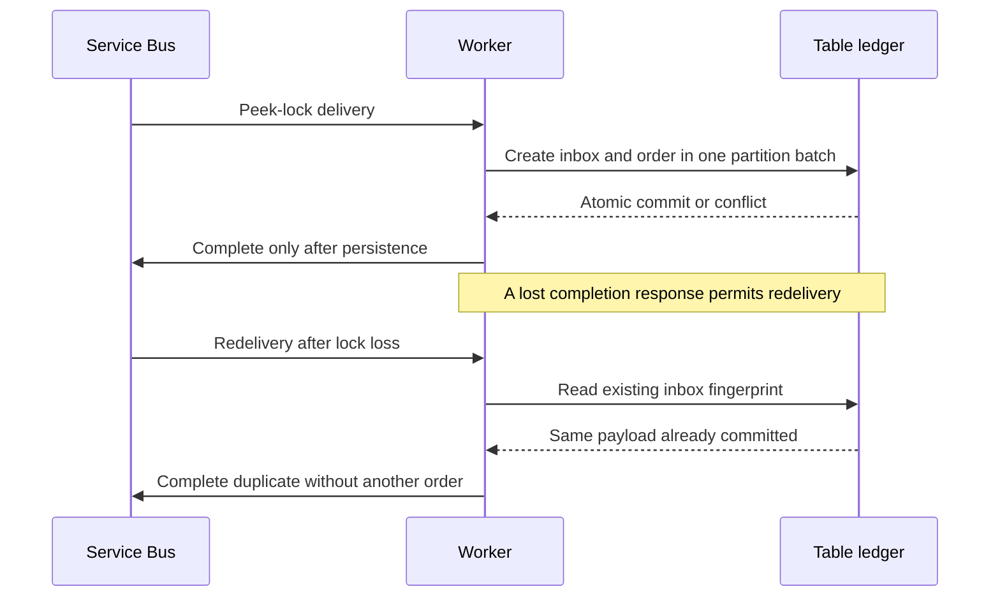

# Architecture and guarantees

## Consistency model

All entity writes are conditional create operations against primary Azure Table storage.
For a new event and a new order, the transaction creates both rows in one tenant partition.
An event conflict is checked first. If the Table batch conflicts, both creates have rolled
back and reconciliation distinguishes an existing event, an existing identical order or a
conflicting order. New event IDs referencing an identical existing order are persisted too.

Table reads after a successful commit on the primary endpoint are strongly consistent. The
adapter uses the original Azure Table endpoint, not a secondary endpoint or Cosmos DB replica.
There is no distributed transaction between Table and Service Bus. Duplicate transport is
expected; immutable order effects are protected while their records are retained. A timeout
on a storage commit is treated as ambiguous failure, never as proof that no write occurred.

## Network and scaling

Service Bus Standard and Standard_LRS Table storage use public TLS endpoints and Entra data
plane authorization. No app ingress is configured. Outbound AMQP/TLS, HTTPS for Storage and
managed identity platform endpoints must remain reachable. An enterprise VNet/private endpoint
variant requires a separate design and may need Service Bus Premium; do not set publicNetworkAccess
Disabled in this lab without supplying that connectivity.

One tenant is one partition, preserving transaction locality but limiting throughput for a hot
tenant. Scale-out is bounded at the container app, not an unlimited response to queue depth.
Message locks last one minute, with auto-renewal up to three minutes. Scale-in or termination
may interrupt processing, but replay reconciliation protects a committed order.

## Deployment stages

main.bicep creates the foundation and role grants. The source commit is built into an ACR image.
worker.bicep consumes that immutable digest and references the foundation resources. The Bicep
files are resource-group-scoped. Their deterministic names include a resource group-derived
suffix where global uniqueness is required. A separate worker stage avoids requiring a private
container image before the registry and identity are created.
